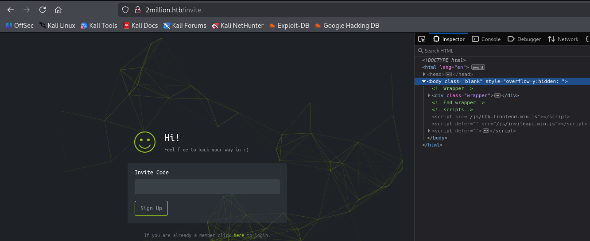
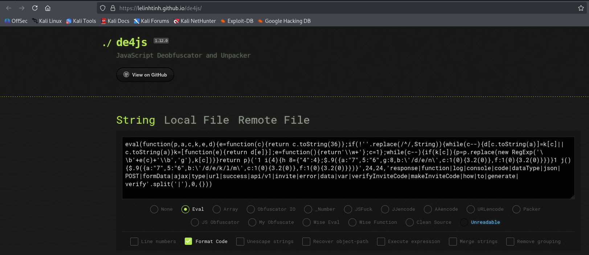
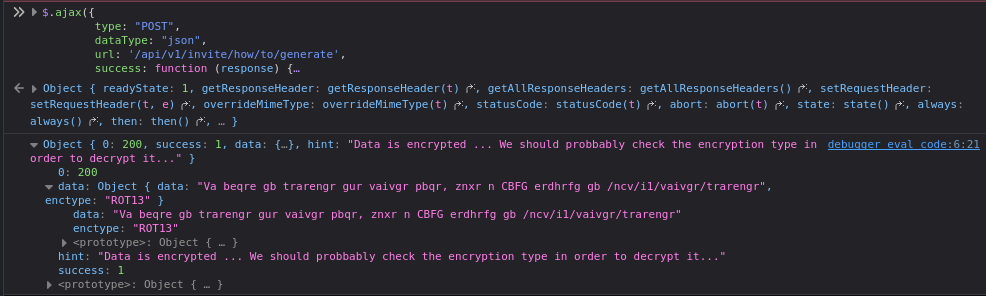
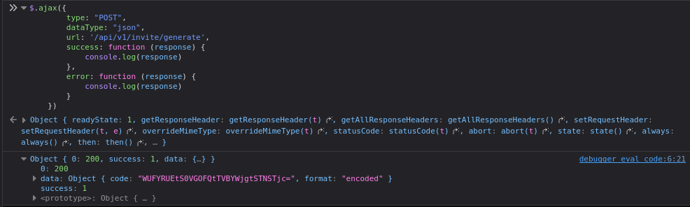
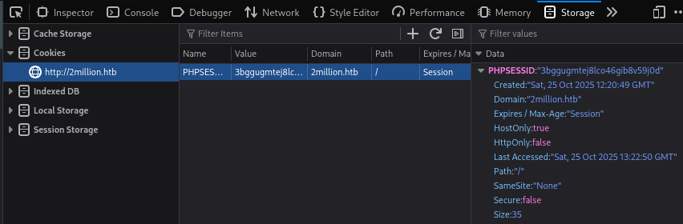
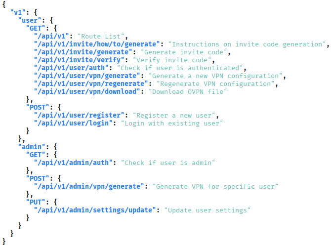

# TwoMillion

- Link : https://app.hackthebox.com/machines/twomillion
- Release date : 07.06.2023
- OS : Linux
- Difficulty : Easy
- Points : 0

## Tools

- nmap
- de4js

## Exploitation

### Finding the first flag

```bash
nmap -sS 10.10.11.221
```

We can see that a JS file `inviteapi.min.js` is loaded.



The file is minified and contains the following code:

```javascript
eval(function(p,a,c,k,e,d){e=function(c){return c.toString(36)};if(!''.replace(/^/,String)){while(c--){d[c.toString(a)]=k[c]||c.toString(a)}k=[function(e){return d[e]}];e=function(){return'\\w+'};c=1};while(c--){if(k[c]){p=p.replace(new RegExp('\\b'+e(c)+'\\b','g'),k[c])}}return p}('1 i(4){h 8={"4":4};$.9({a:"7",5:"6",g:8,b:\'/d/e/n\',c:1(0){3.2(0)},f:1(0){3.2(0)}})}1 j(){$.9({a:"7",5:"6",b:\'/d/e/k/l/m\',c:1(0){3.2(0)},f:1(0){3.2(0)}})}',24,24,'response|function|log|console|code|dataType|json|POST|formData|ajax|type|url|success|api/v1|invite|error|data|var|verifyInviteCode|makeInviteCode|how|to|generate|verify'.split('|'),0,{}))
```

We can use `de4js` to deobfuscate it.



```javascript
function verifyInviteCode(code) {
    var formData = {
        "code": code
    };
    $.ajax({
        type: "POST",
        dataType: "json",
        data: formData,
        url: '/api/v1/invite/verify',
        success: function (response) {
            console.log(response)
        },
        error: function (response) {
            console.log(response)
        }
    })
}

function makeInviteCode() {
    $.ajax({
        type: "POST",
        dataType: "json",
        url: '/api/v1/invite/how/to/generate',
        success: function (response) {
            console.log(response)
        },
        error: function (response) {
            console.log(response)
        }
    })
}
```

By running the `makeInviteCode` function in the browser console, we get a Caesar encrypted text : `Va beqre gb trarengr gur vaivgr pbqr, znxr n CBFG erdhrfg gb /ncv/i1/vaivgr/trarengr`



By decrypting it with a Caesar cipher with a shift of 13, we get : `In order to generate the invite code, make a POST request to /api/v1/invite/generate`.

By making the POST request, we get a code encoded in Base64 : `WUFYRUEtS0VGOFQtTVBYWjgtSTNSTjc=`



We then decode it to get the invite code : `5P2K1-QBD2L-KJ9CB-HBKAX`

We can now sign up and find the admin endpoints using our php session.



```bash
curl 2million.htb/api/v1 --cookie "PHPSESSID=3bggugmtej8lco46gib8v59j0d" | jq
```

